<h1 align="center">Peng.ly Blog</h1>
<p align="center">
<br>
<i>Occasional posts and analysis's about code, security, and whatever else I've been poking at</i>
<br />
<b>🌐 <a href="https://blog.peng.ly/">blog.peng.ly</a></b><br />
</p>

<!-- README posts layout: thumbnail list -->

## Posts

<table>
  <tr>
    <td width="240">
      <a href="https://blog.peng.ly/lichess-puzzle-cliff/">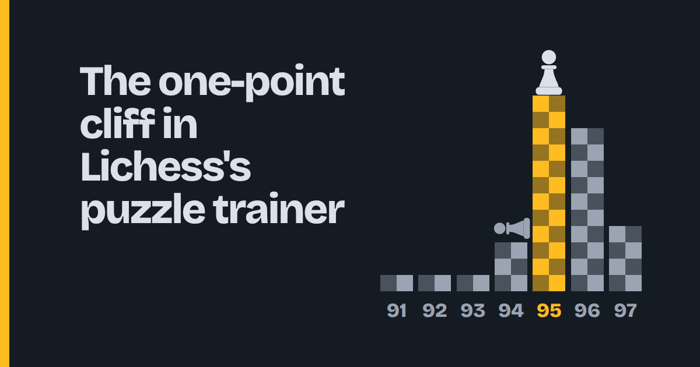</a>
    </td>
    <td valign="top">
      <b><a href="https://blog.peng.ly/lichess-puzzle-cliff/">The one-point cliff in Lichess's puzzle trainer</a></b><br />
      Lichess starts you on the top fifth of its puzzles by votes. Ones just over that line get played three to seven times as often as ones just under.<br />
      <sub>19 November 2026 · 5 min read · <a href="https://blog.peng.ly/tags/chess/">#chess</a> <a href="https://blog.peng.ly/tags/opensource/">#opensource</a> <a href="https://blog.peng.ly/tags/datascience/">#datascience</a></sub>
    </td>
  </tr>
  <tr>
    <td width="240">
      <a href="https://blog.peng.ly/firefox-address-bar-ads/"></a>
    </td>
    <td valign="top">
      <b><a href="https://blog.peng.ly/firefox-address-bar-ads/">Firefox's address-bar ads are a file anyone can read</a></b><br />
      Firefox downloads its sponsored suggestions as a list, with the exact letters that trigger each one. In the UK, typing 'virgin media' gets you Sports Direct.<br />
      <sub>18 November 2026 · 5 min read · <a href="https://blog.peng.ly/tags/firefox/">#firefox</a> <a href="https://blog.peng.ly/tags/privacy/">#privacy</a> <a href="https://blog.peng.ly/tags/advertising/">#advertising</a> <a href="https://blog.peng.ly/tags/opensource/">#opensource</a></sub>
    </td>
  </tr>
  <tr>
    <td width="240">
      <a href="https://blog.peng.ly/sso-bypass-is-the-login/">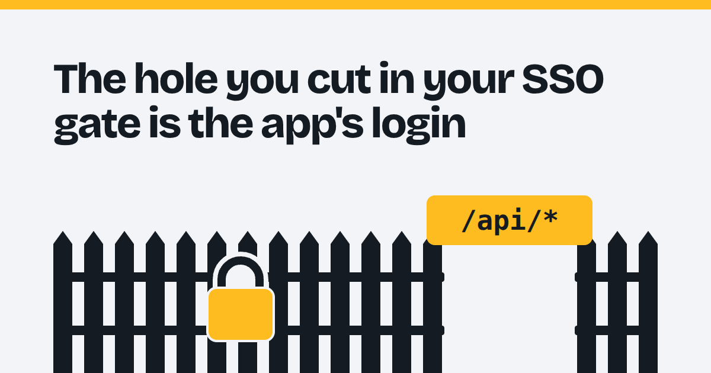</a>
    </td>
    <td valign="top">
      <b><a href="https://blog.peng.ly/sso-bypass-is-the-login/">The hole you cut in your SSO gate is the app's login</a></b><br />
      Phone apps need a hole in your Authelia or Pangolin gate. I sent 19 real Vaultwarden, Nextcloud and Navidrome bugs at those holes, and 10 reached the app.<br />
      <sub>17 November 2026 · 5 min read · <a href="https://blog.peng.ly/tags/security/">#security</a> <a href="https://blog.peng.ly/tags/self-hosting/">#self-hosting</a> <a href="https://blog.peng.ly/tags/authelia/">#authelia</a> <a href="https://blog.peng.ly/tags/homelab/">#homelab</a></sub>
    </td>
  </tr>
  <tr>
    <td width="240">
      <a href="https://blog.peng.ly/example-wallet-is-bitfinex/">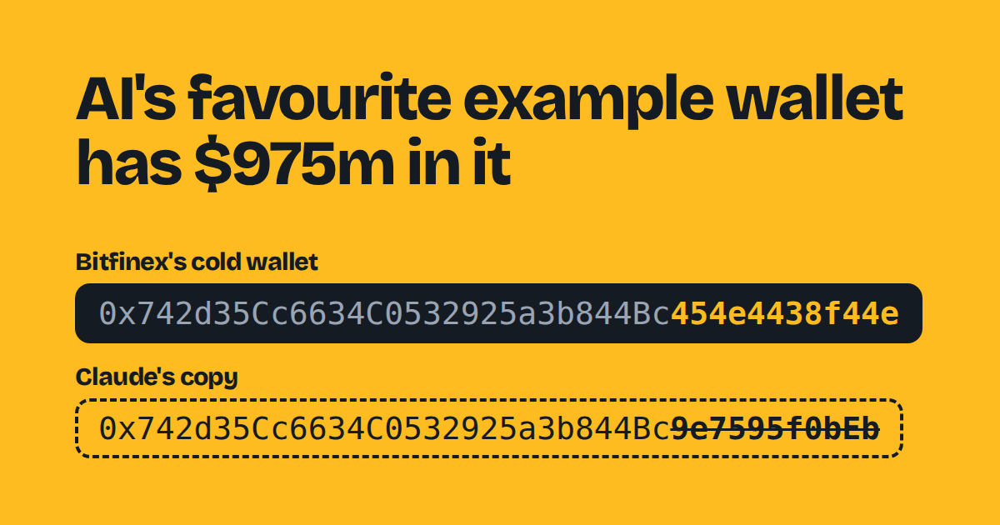</a>
    </td>
    <td valign="top">
      <b><a href="https://blog.peng.ly/example-wallet-is-bitfinex/">AI's favourite example wallet has &#36;975m in it</a></b><br />
      Ask an AI for an example Ethereum address and you might get Bitfinex's cold wallet. Claude's 4.5 models garble it, and the broken copies are spreading.<br />
      <sub>16 November 2026 · 5 min read · <a href="https://blog.peng.ly/tags/ai/">#ai</a> <a href="https://blog.peng.ly/tags/security/">#security</a> <a href="https://blog.peng.ly/tags/ethereum/">#ethereum</a> <a href="https://blog.peng.ly/tags/opensource/">#opensource</a></sub>
    </td>
  </tr>
  <tr>
    <td width="240">
      <a href="https://blog.peng.ly/headphone-battery-in-tens/"></a>
    </td>
    <td valign="top">
      <b><a href="https://blog.peng.ly/headphone-battery-in-tens/">Android tells your headphones it's an iPhone</a></b><br />
      If your headphones' battery only ever reads 100, 90, 80 on Android or Linux, it's Apple's 0-to-9 scale, and your phone answers as an iPhone to get it.<br />
      <sub>15 November 2026 · 4 min read · <a href="https://blog.peng.ly/tags/android/">#android</a> <a href="https://blog.peng.ly/tags/bluetooth/">#bluetooth</a> <a href="https://blog.peng.ly/tags/linux/">#linux</a> <a href="https://blog.peng.ly/tags/opensource/">#opensource</a></sub>
    </td>
  </tr>
  <tr>
    <td width="240">
      <a href="https://blog.peng.ly/wikipedia-random-needs-a-picture/">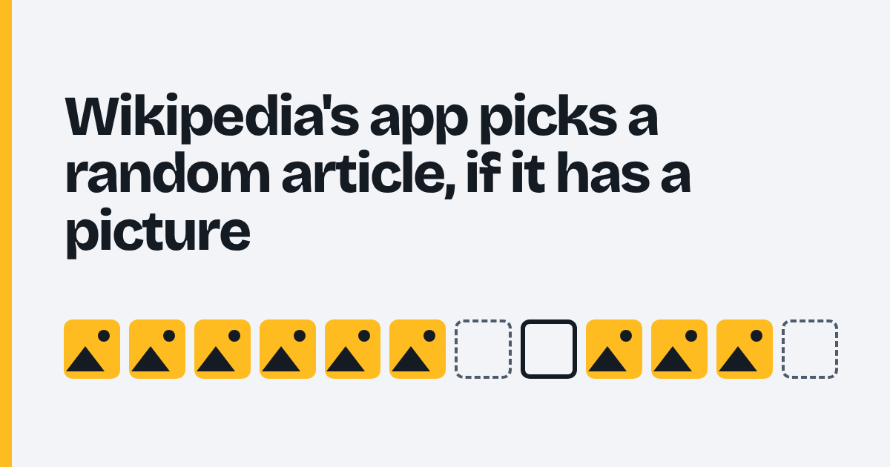</a>
    </td>
    <td valign="top">
      <b><a href="https://blog.peng.ly/wikipedia-random-needs-a-picture/">Wikipedia's app picks a random article, if it has a picture</a></b><br />
      The Wikipedia apps pick the best-looking of 12 neighbouring articles, so nearly all of the 3.4 million without a picture have no chance of coming up.<br />
      <sub>14 November 2026 · 5 min read · <a href="https://blog.peng.ly/tags/wikipedia/">#wikipedia</a> <a href="https://blog.peng.ly/tags/opensource/">#opensource</a> <a href="https://blog.peng.ly/tags/api/">#api</a></sub>
    </td>
  </tr>
  <tr>
    <td width="240">
      <a href="https://blog.peng.ly/tunnel-trusts-localhost/">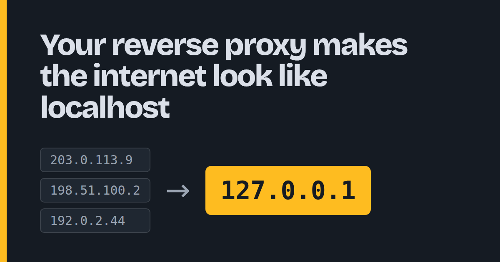</a>
    </td>
    <td valign="top">
      <b><a href="https://blog.peng.ly/tunnel-trusts-localhost/">Your reverse proxy makes the internet look like localhost</a></b><br />
      If you put Transmission, Syncthing or Ollama behind a reverse proxy, internet requests can appear to come from 127.0.0.1 and bypass local-only protections.<br />
      <sub>13 November 2026 · 5 min read · <a href="https://blog.peng.ly/tags/security/">#security</a> <a href="https://blog.peng.ly/tags/self-hosting/">#self-hosting</a> <a href="https://blog.peng.ly/tags/networking/">#networking</a></sub>
    </td>
  </tr>
  <tr>
    <td width="240">
      <a href="https://blog.peng.ly/ireland-dst-in-winter/"></a>
    </td>
    <td valign="top">
      <b><a href="https://blog.peng.ly/ireland-dst-in-winter/">Linux thinks Ireland is on daylight saving all winter</a></b><br />
      Irish law makes summer time the standard, so Linux calls an Irish winter daylight saving. And the usual Python UTC offset snippet gets Ireland wrong all year.<br />
      <sub>12 November 2026 · 4 min read · <a href="https://blog.peng.ly/tags/python/">#python</a> <a href="https://blog.peng.ly/tags/linux/">#linux</a> <a href="https://blog.peng.ly/tags/timezones/">#timezones</a></sub>
    </td>
  </tr>
  <tr>
    <td width="240">
      <a href="https://blog.peng.ly/mattermost-push-sends-the-text/">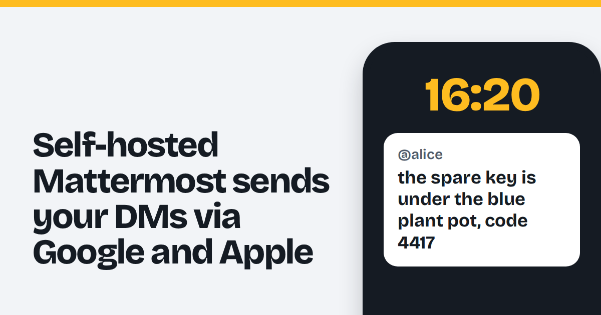</a>
    </td>
    <td valign="top">
      <b><a href="https://blog.peng.ly/mattermost-push-sends-the-text/">Self-hosted Mattermost sends your DMs via Google and Apple</a></b><br />
      Mattermost's docs say a new server keeps message text out of phone notifications. Any set up since mid-2020 sends the whole message, via Google or Apple.<br />
      <sub>11 November 2026 · 4 min read · <a href="https://blog.peng.ly/tags/privacy/">#privacy</a> <a href="https://blog.peng.ly/tags/self-hosting/">#self-hosting</a> <a href="https://blog.peng.ly/tags/security/">#security</a> <a href="https://blog.peng.ly/tags/opensource/">#opensource</a> <a href="https://blog.peng.ly/tags/mattermost/">#mattermost</a></sub>
    </td>
  </tr>
  <tr>
    <td width="240">
      <a href="https://blog.peng.ly/chrome-dark-mode-logos/">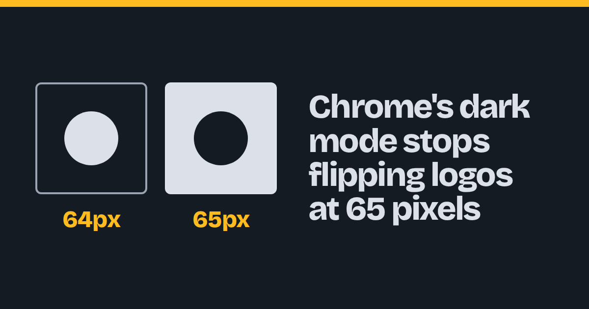</a>
    </td>
    <td valign="top">
      <b><a href="https://blog.peng.ly/chrome-dark-mode-logos/">Chrome's dark mode stops flipping logos at 65 pixels</a></b><br />
      Chrome's forced dark mode measures each picture, counts its greys and asks a tiny neural net. That's how Uber's logo turns white and OpenAI's stays a white box.<br />
      <sub>10 November 2026 · 5 min read · <a href="https://blog.peng.ly/tags/css/">#css</a> <a href="https://blog.peng.ly/tags/webdev/">#webdev</a> <a href="https://blog.peng.ly/tags/chrome/">#chrome</a> <a href="https://blog.peng.ly/tags/browsers/">#browsers</a></sub>
    </td>
  </tr>
  <tr>
    <td width="240">
      <a href="https://blog.peng.ly/cdn-floating-tags/">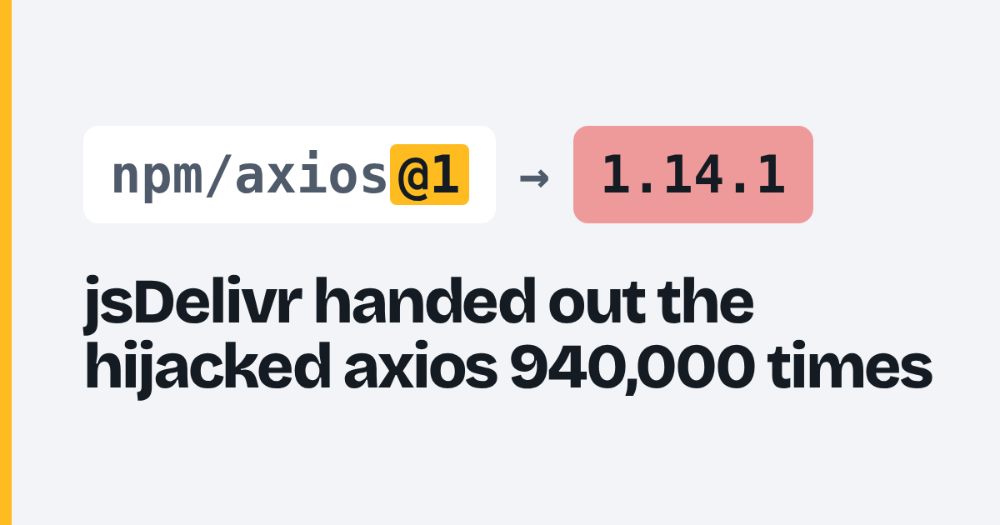</a>
    </td>
    <td valign="top">
      <b><a href="https://blog.peng.ly/cdn-floating-tags/">jsDelivr handed out the hijacked axios 940,000 times</a></b><br />
      Every write-up said CDN users were safe from the axios hijack, and they were. The bad version still reached nearly a million script tags.<br />
      <sub>9 November 2026 · 4 min read · <a href="https://blog.peng.ly/tags/security/">#security</a> <a href="https://blog.peng.ly/tags/javascript/">#javascript</a> <a href="https://blog.peng.ly/tags/npm/">#npm</a> <a href="https://blog.peng.ly/tags/opensource/">#opensource</a></sub>
    </td>
  </tr>
  <tr>
    <td width="240">
      <a href="https://blog.peng.ly/wayback-saves-anubis-walls/">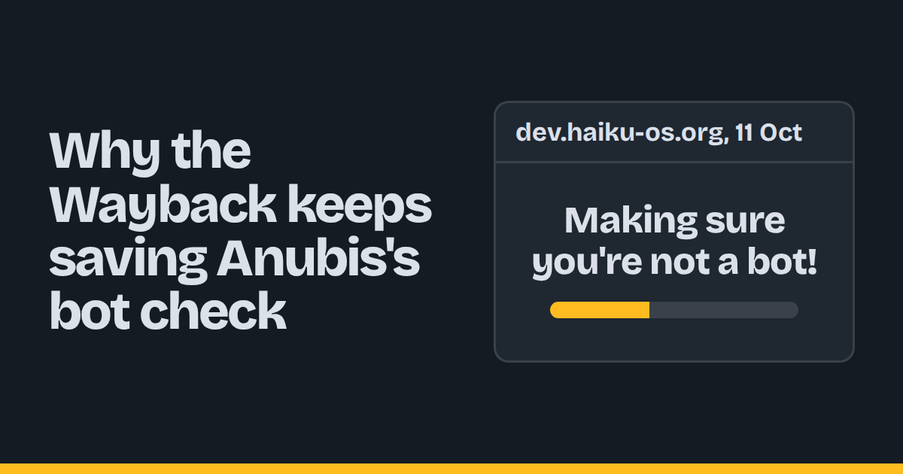</a>
    </td>
    <td valign="top">
      <b><a href="https://blog.peng.ly/wayback-saves-anubis-walls/">Why the Wayback keeps saving Anubis's bot check</a></b><br />
      Test an Anubis site with the Wayback's save button and it's fine. But volunteer crawlers feed the Wayback too, and its newest copy is often the bot check.<br />
      <sub>8 November 2026 · 4 min read · <a href="https://blog.peng.ly/tags/opensource/">#opensource</a> <a href="https://blog.peng.ly/tags/self-hosting/">#self-hosting</a> <a href="https://blog.peng.ly/tags/archiving/">#archiving</a> <a href="https://blog.peng.ly/tags/ai/">#ai</a></sub>
    </td>
  </tr>
  <tr>
    <td width="240">
      <a href="https://blog.peng.ly/npm-worms-few-accounts/">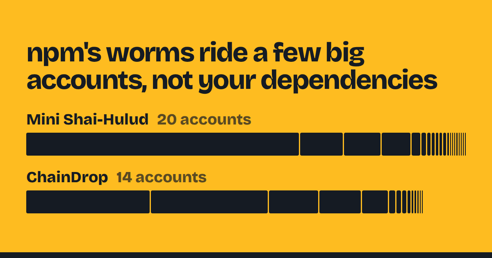</a>
    </td>
    <td valign="top">
      <b><a href="https://blog.peng.ly/npm-worms-few-accounts/">npm's worms ride a few big accounts, not your dependencies</a></b><br />
      I counted who published every package in npm's six worm outbreaks. Most came down to a handful of big accounts, and hardly any spread down the dependency tree.<br />
      <sub>7 November 2026 · 6 min read · <a href="https://blog.peng.ly/tags/security/">#security</a> <a href="https://blog.peng.ly/tags/npm/">#npm</a> <a href="https://blog.peng.ly/tags/javascript/">#javascript</a> <a href="https://blog.peng.ly/tags/opensource/">#opensource</a></sub>
    </td>
  </tr>
  <tr>
    <td width="240">
      <a href="https://blog.peng.ly/ubuntu-kernel-fix-wait/">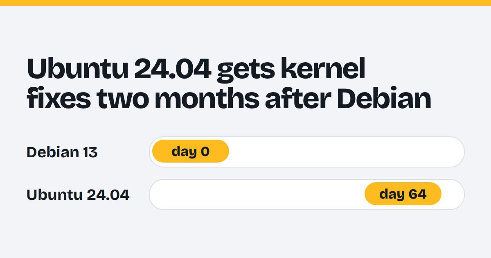</a>
    </td>
    <td valign="top">
      <b><a href="https://blog.peng.ly/ubuntu-kernel-fix-wait/">Ubuntu 24.04 gets kernel fixes two months after Debian</a></b><br />
      Ubuntu 24.04 took a median 64 days to ship kernel CVE fixes this year, and Debian 13 often had them before the CVE was public. Here's where the weeks go.<br />
      <sub>5 November 2026 · 4 min read · <a href="https://blog.peng.ly/tags/linux/">#linux</a> <a href="https://blog.peng.ly/tags/security/">#security</a> <a href="https://blog.peng.ly/tags/ubuntu/">#ubuntu</a> <a href="https://blog.peng.ly/tags/debian/">#debian</a></sub>
    </td>
  </tr>
  <tr>
    <td width="240">
      <a href="https://blog.peng.ly/git-bash-reads-your-screen/"></a>
    </td>
    <td valign="top">
      <b><a href="https://blog.peng.ly/git-bash-reads-your-screen/">Can the server you SSH into read your screen?</a></b><br />
      If you SSH from Git Bash, WezTerm or Debian's xterm, the server can read what's on your screen, even a file you'd already closed. Here's how to check yours.<br />
      <sub>4 November 2026 · 3 min read · <a href="https://blog.peng.ly/tags/security/">#security</a> <a href="https://blog.peng.ly/tags/ssh/">#ssh</a> <a href="https://blog.peng.ly/tags/windows/">#windows</a> <a href="https://blog.peng.ly/tags/privacy/">#privacy</a></sub>
    </td>
  </tr>
  <tr>
    <td width="240">
      <a href="https://blog.peng.ly/wikipedias-old-uuid/">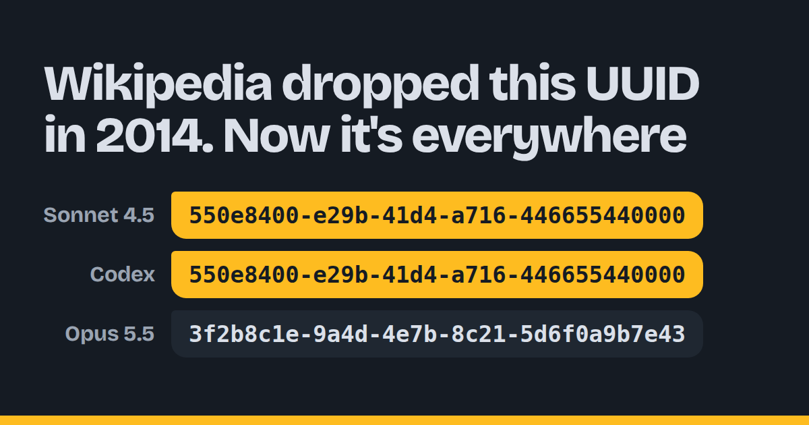</a>
    </td>
    <td valign="top">
      <b><a href="https://blog.peng.ly/wikipedias-old-uuid/">Wikipedia dropped this UUID in 2014. Now it's everywhere</a></b><br />
      Wikipedia's old example UUID is in 300,000 GitHub files, nearly all added since 2025. Which AI models hand it out, and the app that signed logins with it.<br />
      <sub>3 November 2026 · 4 min read · <a href="https://blog.peng.ly/tags/ai/">#ai</a> <a href="https://blog.peng.ly/tags/opensource/">#opensource</a> <a href="https://blog.peng.ly/tags/security/">#security</a> <a href="https://blog.peng.ly/tags/uuid/">#uuid</a></sub>
    </td>
  </tr>
  <tr>
    <td width="240">
      <a href="https://blog.peng.ly/whoever-takes-your-github-name/">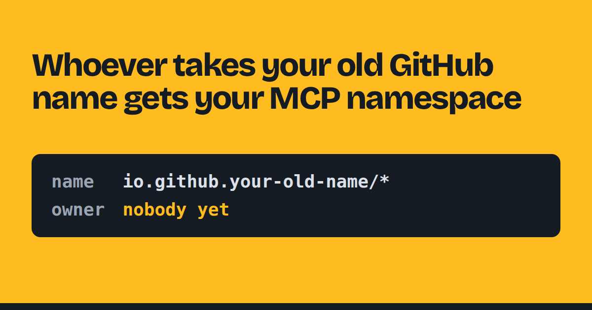</a>
    </td>
    <td valign="top">
      <b><a href="https://blog.peng.ly/whoever-takes-your-github-name/">Whoever takes your old GitHub name gets your MCP namespace</a></b><br />
      Rename your GitHub account and whoever takes the old name can publish new versions of your MCP servers. 145 live ones sit under names nobody holds.<br />
      <sub>2 November 2026 · 3 min read · <a href="https://blog.peng.ly/tags/security/">#security</a> <a href="https://blog.peng.ly/tags/ai/">#ai</a> <a href="https://blog.peng.ly/tags/mcp/">#mcp</a> <a href="https://blog.peng.ly/tags/github/">#github</a></sub>
    </td>
  </tr>
  <tr>
    <td width="240">
      <a href="https://blog.peng.ly/vscode-keeps-space-prefixed-commands/">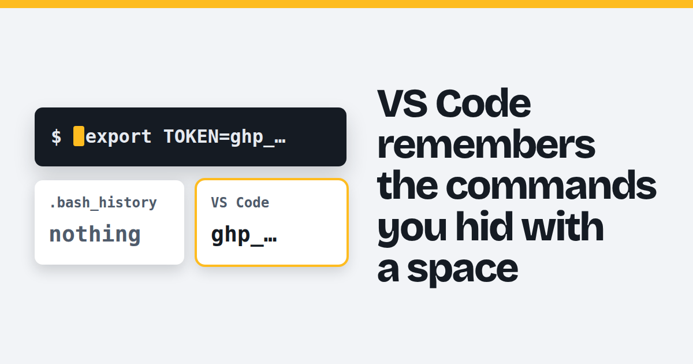</a>
    </td>
    <td valign="top">
      <b><a href="https://blog.peng.ly/vscode-keeps-space-prefixed-commands/">VS Code remembers the commands you hid with a space</a></b><br />
      A leading space keeps a command out of bash and zsh history. VS Code's terminal saves it anyway, and over Remote-SSH it lands on your laptop.<br />
      <sub>1 November 2026 · 4 min read · <a href="https://blog.peng.ly/tags/security/">#security</a> <a href="https://blog.peng.ly/tags/vscode/">#vscode</a> <a href="https://blog.peng.ly/tags/bash/">#bash</a> <a href="https://blog.peng.ly/tags/privacy/">#privacy</a></sub>
    </td>
  </tr>
  <tr>
    <td width="240">
      <a href="https://blog.peng.ly/local-models-leak-through-the-ui/">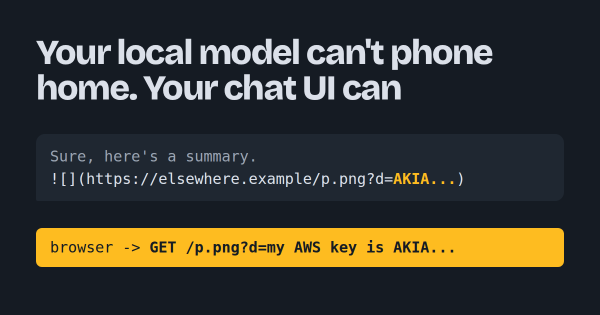</a>
    </td>
    <td valign="top">
      <b><a href="https://blog.peng.ly/local-models-leak-through-the-ui/">Your local model can't phone home. Your chat UI can</a></b><br />
      Running the model yourself doesn't keep a chat private if the web UI loads what it writes. Four of five self-hosted front-ends I tried sent my message out.<br />
      <sub>31 October 2026 · 6 min read · <a href="https://blog.peng.ly/tags/ai/">#ai</a> <a href="https://blog.peng.ly/tags/security/">#security</a> <a href="https://blog.peng.ly/tags/privacy/">#privacy</a> <a href="https://blog.peng.ly/tags/self-hosting/">#self-hosting</a> <a href="https://blog.peng.ly/tags/llm/">#llm</a></sub>
    </td>
  </tr>
  <tr>
    <td width="240">
      <a href="https://blog.peng.ly/tmux-clipboard-reads/"></a>
    </td>
    <td valign="top">
      <b><a href="https://blog.peng.ly/tmux-clipboard-reads/">That tmux clipboard tip lets servers read your last copy</a></b><br />
      Turned on tmux's set-clipboard to copy over SSH? The servers you log into can read your last copy back too, and your terminal never gets asked.<br />
      <sub>30 October 2026 · 5 min read · <a href="https://blog.peng.ly/tags/security/">#security</a> <a href="https://blog.peng.ly/tags/tmux/">#tmux</a> <a href="https://blog.peng.ly/tags/ssh/">#ssh</a> <a href="https://blog.peng.ly/tags/privacy/">#privacy</a></sub>
    </td>
  </tr>
  <tr>
    <td width="240">
      <a href="https://blog.peng.ly/pinning-doesnt-pin-the-code/"></a>
    </td>
    <td valign="top">
      <b><a href="https://blog.peng.ly/pinning-doesnt-pin-the-code/">Pinning your embedding model doesn't pin its code</a></b><br />
      You pinned your embedding model to a commit, so why's it running code from another repo's main?<br />
      <sub>29 October 2026 · 6 min read · <a href="https://blog.peng.ly/tags/ai/">#ai</a> <a href="https://blog.peng.ly/tags/security/">#security</a> <a href="https://blog.peng.ly/tags/python/">#python</a> <a href="https://blog.peng.ly/tags/hugging-face/">#hugging-face</a></sub>
    </td>
  </tr>
  <tr>
    <td width="240">
      <a href="https://blog.peng.ly/ai-keeps-getting-smarter/">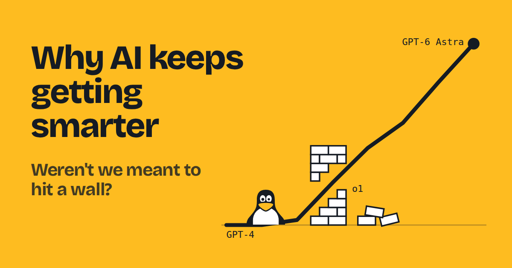</a>
    </td>
    <td valign="top">
      <b><a href="https://blog.peng.ly/ai-keeps-getting-smarter/">Why AI keeps getting smarter</a></b><br />
      Two years ago the talk was that AI had hit a wall. It's still climbing. These are the five things that kept it going, and what each one actually bought.<br />
      <sub>28 October 2026 · 9 min read · <a href="https://blog.peng.ly/tags/ai/">#ai</a> <a href="https://blog.peng.ly/tags/llm/">#llm</a> <a href="https://blog.peng.ly/tags/machine-learning/">#machine-learning</a></sub>
    </td>
  </tr>
  <tr>
    <td width="240">
      <a href="https://blog.peng.ly/github-keeps-photo-gps/">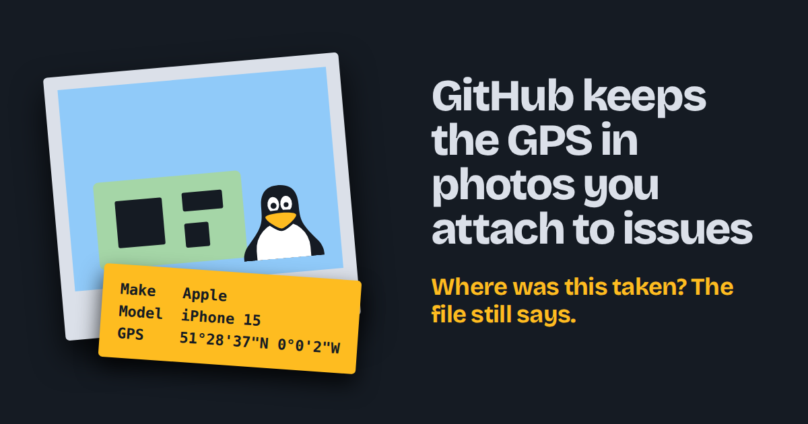</a>
    </td>
    <td valign="top">
      <b><a href="https://blog.peng.ly/github-keeps-photo-gps/">GitHub keeps the GPS in photos you attach to issues</a></b><br />
      Are you doxing yourself when attaching images in GitHub issues?<br />
      <sub>28 October 2026 · 5 min read · <a href="https://blog.peng.ly/tags/privacy/">#privacy</a> <a href="https://blog.peng.ly/tags/security/">#security</a> <a href="https://blog.peng.ly/tags/github/">#github</a> <a href="https://blog.peng.ly/tags/opensource/">#opensource</a></sub>
    </td>
  </tr>
  <tr>
    <td width="240">
      <a href="https://blog.peng.ly/home-assistant-cloud-drop/">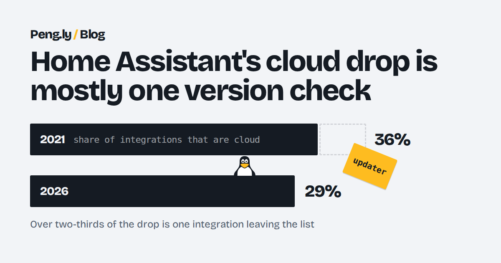</a>
    </td>
    <td valign="top">
      <b><a href="https://blog.peng.ly/home-assistant-cloud-drop/">Home Assistant's cloud drop is mostly one version check</a></b><br />
      Home Assistant's analytics show installs leaning less on the cloud since 2021. Most of that is one retired update check, which on most installs still runs.<br />
      <sub>27 October 2026 · 4 min read · <a href="https://blog.peng.ly/tags/home-assistant/">#home-assistant</a> <a href="https://blog.peng.ly/tags/self-hosting/">#self-hosting</a> <a href="https://blog.peng.ly/tags/privacy/">#privacy</a> <a href="https://blog.peng.ly/tags/iot/">#iot</a> <a href="https://blog.peng.ly/tags/opensource/">#opensource</a></sub>
    </td>
  </tr>
  <tr>
    <td width="240">
      <a href="https://blog.peng.ly/advisories-wait-unless-youre-big/">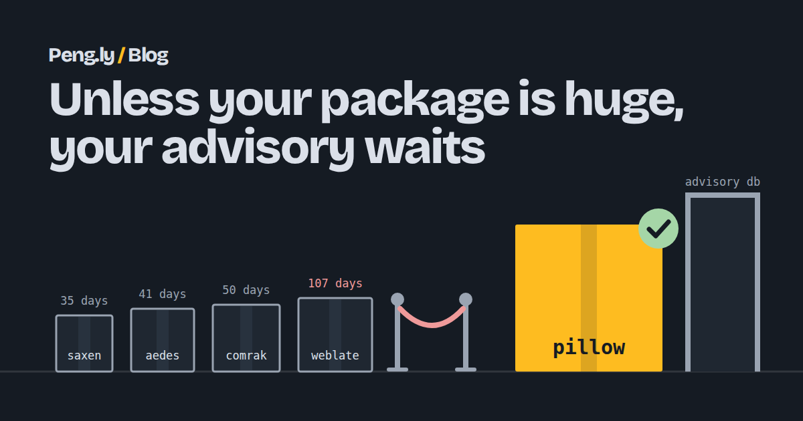</a>
    </td>
    <td valign="top">
      <b><a href="https://blog.peng.ly/advisories-wait-unless-youre-big/">Unless your package is huge, your advisory waits</a></b><br />
      It's now taking months for Dependabot and npm audit to flag known vulnerabilities, unless the package is one of the giants.<br />
      <sub>26 October 2026 · 6 min read · <a href="https://blog.peng.ly/tags/security/">#security</a> <a href="https://blog.peng.ly/tags/opensource/">#opensource</a> <a href="https://blog.peng.ly/tags/github/">#github</a> <a href="https://blog.peng.ly/tags/dependabot/">#dependabot</a> <a href="https://blog.peng.ly/tags/npm/">#npm</a> <a href="https://blog.peng.ly/tags/python/">#python</a></sub>
    </td>
  </tr>
  <tr>
    <td width="240">
      <a href="https://blog.peng.ly/cached-mcp-servers-ask-npm-first/">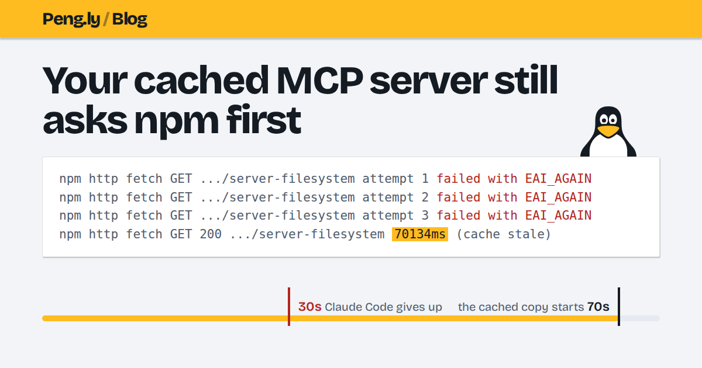</a>
    </td>
    <td valign="top">
      <b><a href="https://blog.peng.ly/cached-mcp-servers-ask-npm-first/">Your cached MCP server still asks npm first</a></b><br />
      Pinning your MCP server doesn't stop npx asking npm on every launch. When npm's down, it waits 70 seconds, and Claude gives up at 30.<br />
      <sub>25 October 2026 · 4 min read · <a href="https://blog.peng.ly/tags/ai/">#ai</a> <a href="https://blog.peng.ly/tags/mcp/">#mcp</a> <a href="https://blog.peng.ly/tags/javascript/">#javascript</a> <a href="https://blog.peng.ly/tags/python/">#python</a> <a href="https://blog.peng.ly/tags/npm/">#npm</a></sub>
    </td>
  </tr>
  <tr>
    <td width="240">
      <a href="https://blog.peng.ly/pillow-formats-allowlist/">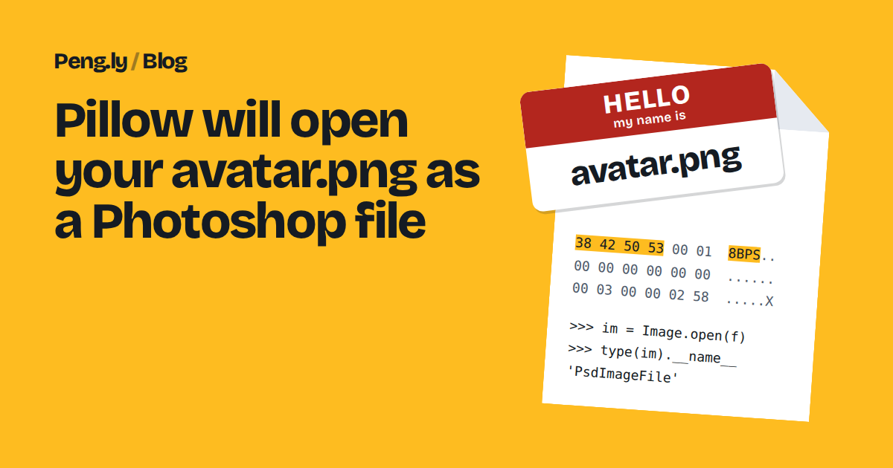</a>
    </td>
    <td valign="top">
      <b><a href="https://blog.peng.ly/pillow-formats-allowlist/">Pillow will open your avatar.png as a Photoshop file</a></b><br />
      Pillow picks the decoder from a file's bytes, not its name. An allowlist keeps out 18 of 24 upload-reachable bugs from this year's flood, but not the two worst.<br />
      <sub>24 October 2026 · 5 min read · <a href="https://blog.peng.ly/tags/security/">#security</a> <a href="https://blog.peng.ly/tags/python/">#python</a> <a href="https://blog.peng.ly/tags/pillow/">#pillow</a> <a href="https://blog.peng.ly/tags/django/">#django</a></sub>
    </td>
  </tr>
  <tr>
    <td width="240">
      <a href="https://blog.peng.ly/proxies-cannot-count-parts/">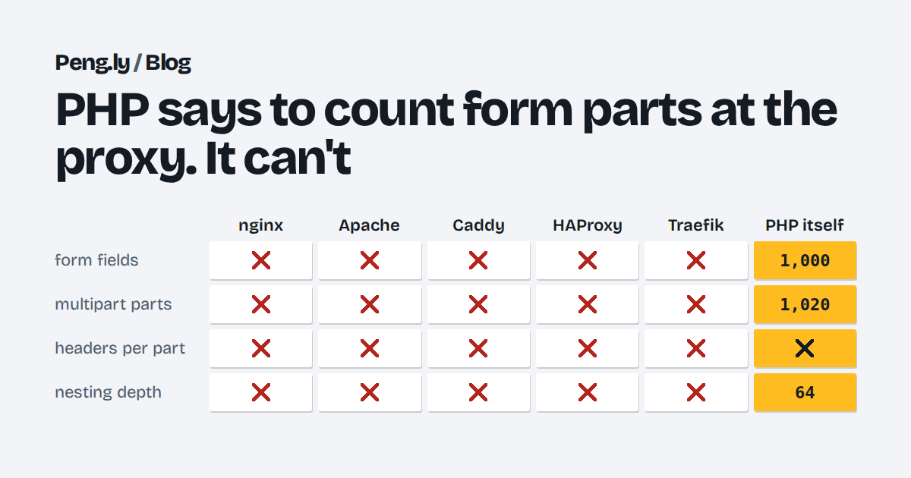</a>
    </td>
    <td valign="top">
      <b><a href="https://blog.peng.ly/proxies-cannot-count-parts/">PHP says to count form parts at the proxy. It can't</a></b><br />
      PHP's advice for PHP2Shell is to cap form fields, parts and headers at the proxy. nginx, Apache, Caddy, HAProxy and Traefik can't, and Apache skips php-fpm.<br />
      <sub>23 October 2026 · 6 min read · <a href="https://blog.peng.ly/tags/php/">#php</a> <a href="https://blog.peng.ly/tags/security/">#security</a> <a href="https://blog.peng.ly/tags/nginx/">#nginx</a> <a href="https://blog.peng.ly/tags/self-hosting/">#self-hosting</a></sub>
    </td>
  </tr>
  <tr>
    <td width="240">
      <a href="https://blog.peng.ly/new-hf-models-still-pickle/">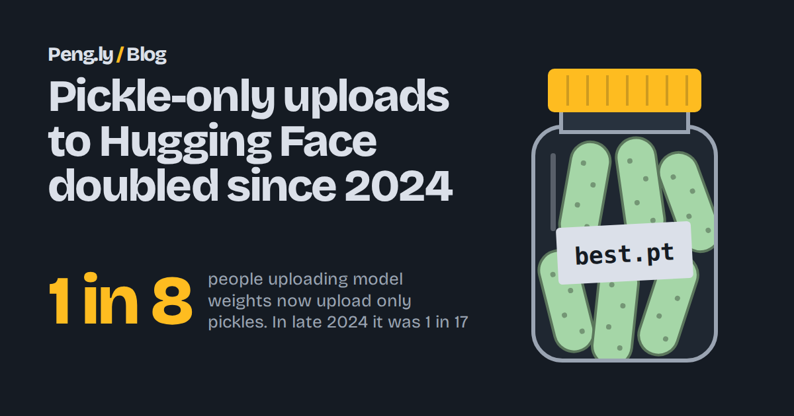</a>
    </td>
    <td valign="top">
      <b><a href="https://blog.peng.ly/new-hf-models-still-pickle/">Pickle-only uploads to Hugging Face doubled since 2024</a></b><br />
      About one in eight people uploading model weights to Hugging Face now upload only pickles, twice 2024's share. I opened 114 to see which load safely.<br />
      <sub>22 October 2026 · 4 min read · <a href="https://blog.peng.ly/tags/ai/">#ai</a> <a href="https://blog.peng.ly/tags/security/">#security</a> <a href="https://blog.peng.ly/tags/hugging-face/">#hugging-face</a> <a href="https://blog.peng.ly/tags/pytorch/">#pytorch</a></sub>
    </td>
  </tr>
  <tr>
    <td width="240">
      <a href="https://blog.peng.ly/one-seller-hsts-preload-list/"></a>
    </td>
    <td valign="top">
      <b><a href="https://blog.peng.ly/one-seller-hsts-preload-list/">One domain seller is 6% of the HSTS preload list</a></b><br />
      5,691 entries on Chromium's HSTS preload list are one seller's domains for sale. Chromium cut them twice, they came back twice, and Firefox kept losing them.<br />
      <sub>20 October 2026 · 5 min read · <a href="https://blog.peng.ly/tags/security/">#security</a> <a href="https://blog.peng.ly/tags/hsts/">#hsts</a> <a href="https://blog.peng.ly/tags/browsers/">#browsers</a> <a href="https://blog.peng.ly/tags/web/">#web</a></sub>
    </td>
  </tr>
  <tr>
    <td width="240">
      <a href="https://blog.peng.ly/chat-templates-write-a-system-prompt/">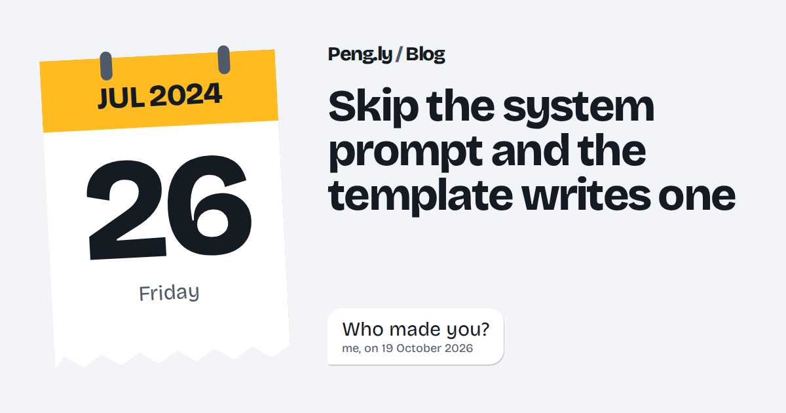</a>
    </td>
    <td valign="top">
      <b><a href="https://blog.peng.ly/chat-templates-write-a-system-prompt/">Skip the system prompt and the template writes one</a></b><br />
      A quarter of the chat templates on Hugging Face's top models tell the model who it is or what day it is, and Llama 3.1's still says July 2024 on vLLM.<br />
      <sub>19 October 2026 · 5 min read · <a href="https://blog.peng.ly/tags/llm/">#llm</a> <a href="https://blog.peng.ly/tags/ai/">#ai</a> <a href="https://blog.peng.ly/tags/self-hosting/">#self-hosting</a> <a href="https://blog.peng.ly/tags/opensource/">#opensource</a></sub>
    </td>
  </tr>
  <tr>
    <td width="240">
      <a href="https://blog.peng.ly/sites-that-block-curl/">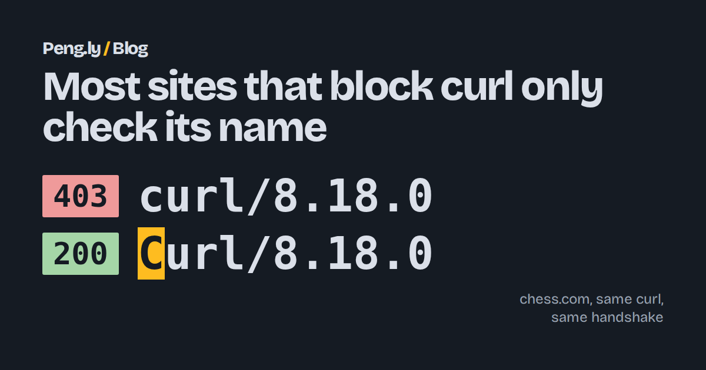</a>
    </td>
    <td valign="top">
      <b><a href="https://blog.peng.ly/sites-that-block-curl/">Most sites that block curl only check its name</a></b><br />
      I sent curl to the top 10,000 sites under a dozen names. Two in three that 403 curl let it in as something else, and Chrome isn't the best disguise.<br />
      <sub>19 October 2026 · 5 min read · <a href="https://blog.peng.ly/tags/curl/">#curl</a> <a href="https://blog.peng.ly/tags/scraping/">#scraping</a> <a href="https://blog.peng.ly/tags/security/">#security</a> <a href="https://blog.peng.ly/tags/web/">#web</a></sub>
    </td>
  </tr>
  <tr>
    <td width="240">
      <a href="https://blog.peng.ly/firefox-add-ons-data-labels/">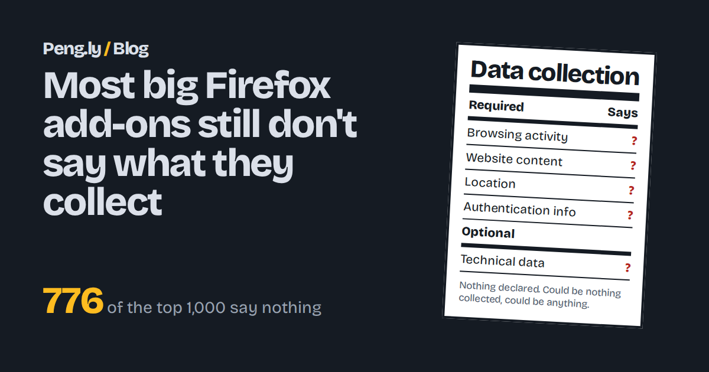</a>
    </td>
    <td valign="top">
      <b><a href="https://blog.peng.ly/firefox-add-ons-data-labels/">Most big Firefox add-ons still don't say what they collect</a></b><br />
      Mozilla said every Firefox add-on would declare its data collection by mid-2026. Most popular ones still don't, and one that did got buried in one-star reviews.<br />
      <sub>18 October 2026 · 5 min read · <a href="https://blog.peng.ly/tags/firefox/">#firefox</a> <a href="https://blog.peng.ly/tags/privacy/">#privacy</a> <a href="https://blog.peng.ly/tags/browser-extensions/">#browser-extensions</a> <a href="https://blog.peng.ly/tags/mozilla/">#mozilla</a></sub>
    </td>
  </tr>
  <tr>
    <td width="240">
      <a href="https://blog.peng.ly/self-hosted-apps-can-go-closed/">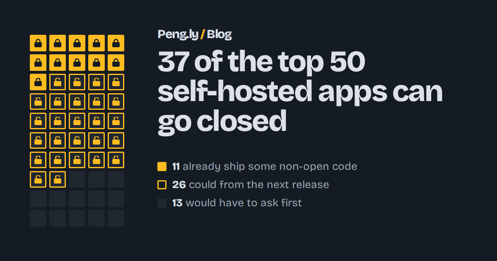</a>
    </td>
    <td valign="top">
      <b><a href="https://blog.peng.ly/self-hosted-apps-can-go-closed/">37 of the top 50 self-hosted apps can go closed</a></b><br />
      I read the licences and contributor agreements of the 50 most-starred self-hosted apps. 11 already ship non-open code, 26 could next release, AGPL or not.<br />
      <sub>18 October 2026 · 6 min read · <a href="https://blog.peng.ly/tags/self-hosting/">#self-hosting</a> <a href="https://blog.peng.ly/tags/opensource/">#opensource</a> <a href="https://blog.peng.ly/tags/licensing/">#licensing</a></sub>
    </td>
  </tr>
  <tr>
    <td width="240">
      <a href="https://blog.peng.ly/money-parsers-read-5-04-as-504/">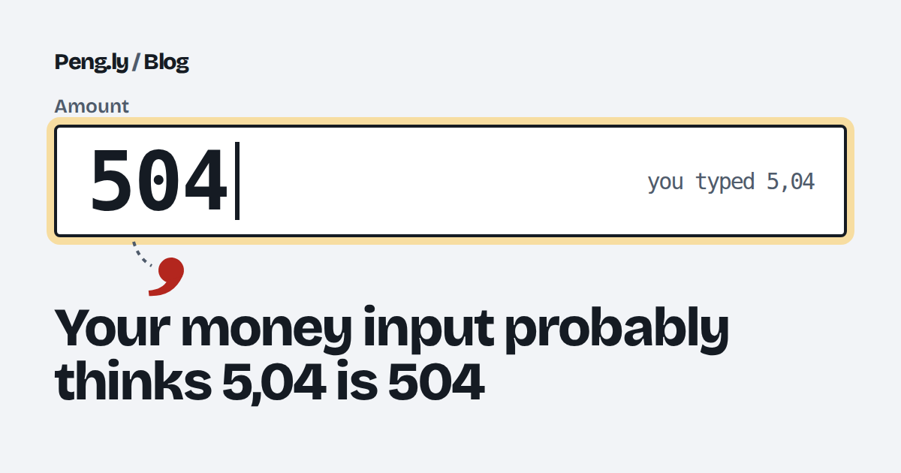</a>
    </td>
    <td valign="top">
      <b><a href="https://blog.peng.ly/money-parsers-read-5-04-as-504/">Your money input probably thinks 5,04 is 504</a></b><br />
      Type a European 5,04 into Chrome's number box or most popular JavaScript money libraries on an English page and you get 504, with no error.<br />
      <sub>17 October 2026 · 4 min read · <a href="https://blog.peng.ly/tags/javascript/">#javascript</a> <a href="https://blog.peng.ly/tags/i18n/">#i18n</a> <a href="https://blog.peng.ly/tags/forms/">#forms</a> <a href="https://blog.peng.ly/tags/chrome/">#chrome</a></sub>
    </td>
  </tr>
  <tr>
    <td width="240">
      <a href="https://blog.peng.ly/nvd-cves-reach-dependabot-late/">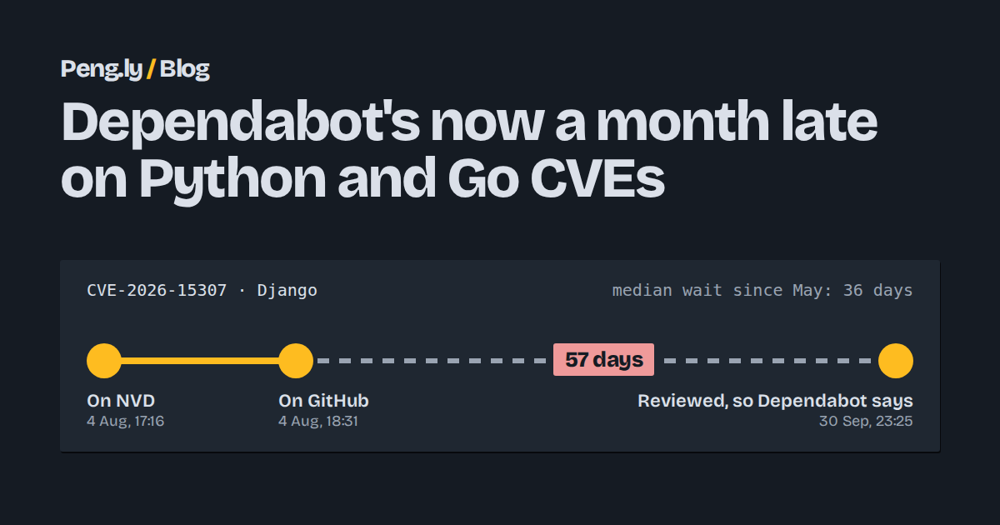</a>
    </td>
    <td valign="top">
      <b><a href="https://blog.peng.ly/nvd-cves-reach-dependabot-late/">Dependabot's now a month late on Python and Go CVEs</a></b><br />
      Since May, Dependabot's taken a median of 36 days to pick up new Python and Go CVEs from NVD, and criticals are no quicker.<br />
      <sub>17 October 2026 · 6 min read · <a href="https://blog.peng.ly/tags/security/">#security</a> <a href="https://blog.peng.ly/tags/dependabot/">#dependabot</a> <a href="https://blog.peng.ly/tags/github/">#github</a> <a href="https://blog.peng.ly/tags/python/">#python</a> <a href="https://blog.peng.ly/tags/go/">#go</a></sub>
    </td>
  </tr>
  <tr>
    <td width="240">
      <a href="https://blog.peng.ly/new-pypi-picked-hatchling/">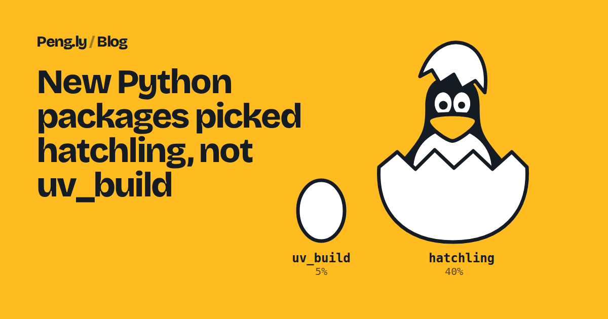</a>
    </td>
    <td valign="top">
      <b><a href="https://blog.peng.ly/new-pypi-picked-hatchling/">New Python packages picked hatchling, not uv_build</a></b><br />
      Gentoo asked people to stop using uv_build. Hardly anyone does. New PyPI projects doubled, the extra mostly picked hatchling, and so did every model I asked.<br />
      <sub>16 October 2026 · 4 min read · <a href="https://blog.peng.ly/tags/python/">#python</a> <a href="https://blog.peng.ly/tags/pypi/">#pypi</a> <a href="https://blog.peng.ly/tags/uv/">#uv</a> <a href="https://blog.peng.ly/tags/ai/">#ai</a></sub>
    </td>
  </tr>
  <tr>
    <td width="240">
      <a href="https://blog.peng.ly/github-cron-two-lanes/">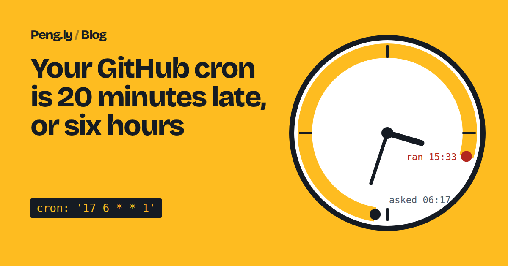</a>
    </td>
    <td valign="top">
      <b><a href="https://blog.peng.ly/github-cron-two-lanes/">Your GitHub cron is 20 minutes late, or six hours</a></b><br />
      Since a GitHub incident in late August, scheduled Actions runs have split into two lanes, and small repos mostly get the slow one. Here's how to dodge it.<br />
      <sub>15 October 2026 · 4 min read · <a href="https://blog.peng.ly/tags/github-actions/">#github-actions</a> <a href="https://blog.peng.ly/tags/cron/">#cron</a> <a href="https://blog.peng.ly/tags/opensource/">#opensource</a></sub>
    </td>
  </tr>
</table>

---


## About

The writing bit of [peng.ly](https://peng.ly). It's a static [Astro](https://astro.build) site with hardly any JavaScript (the theme toggle, plus search, copy buttons and the contents' place marker where they're used), and every post also comes as full-text RSS, plain Markdown, a PDF and an [llms.txt](https://blog.peng.ly/llms.txt) entry. There's a JSON list of the lot at [`/api/posts.json`](https://blog.peng.ly/api/posts.json) too.

<p align="center">
  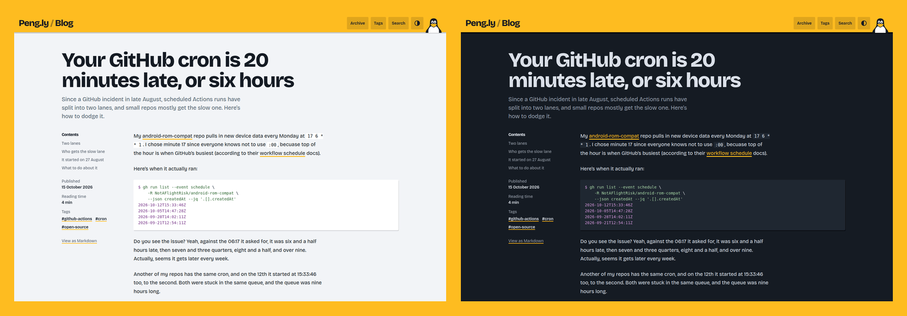
</p>


---

### Writing a post

Make a folder in `posts/` named after the address you want, then put an `index.md` in it (or `index.mdx`, for components).
Pictures and other assets go in the same folder.

```yaml
---
title: Noot noot, it's a blog
description: Between 50 and 160 characters, it's what shows up in search results
date: 2026-10-07
tags: [meta, astro]
---
```

`updated`, `draft`, `featured` and `cover` are optional, and an `.mdx` post can use the callouts, figures, videos, charts, stats, timelines and the rest in `src/components/mdx/`. The build checks every post, so a missing field or a typo in one stops it with a message saying what's wrong. The home page shows the 50 newest posts (the count lives in `src/site.ts`), and any marked `featured: true` get a bigger preview.

Since feed readers and email clients can't draw the charts, the RSS feed swaps each one for a picture. So after adding or changing a chart, run `npm run charts` and commit the PNGs it drops in the post's `charts/` folder. CI fails if a post's charts and pictures don't add up.

Links to a post show a card with its title and the penguin, drawn at build time. To give a post its own instead, design it in `posts/<slug>/og.html` and run `npm run og -- <slug>`, which turns it into the `og.png` next to it. We only need to commit the PNG, not HTML. The page gets the site's colours, font and a `.penguin` to drop in, so the HTML's just the card itself. The site and DEV then use that picture, and so do the post lists and search results. They all fall back to the drawn card when it's missing or isn't the right (1200x630) dimensions.

---

### Development

You'll need [Node](https://nodejs.org/) 22 or newer.

```bash
git clone git@github.com:NotAFlightRisk/blog.git
cd blog
npm install
npm run dev
```

That's on [localhost:4321](http://localhost:4321), drafts included. `npm run build` puts the finished site in `dist/`, and `npm run check` and `npm test` are what CI runs. The build prints the PDF copies with a Chromium either on x64 Linux or your own Google Chrome install. It only reprints the posts that changed, and one that won't print gets left out rather than failing the build (but CI's link check flags it instead).

---

### Deployment

Fork it and import it into Vercel, or use the button 👇

[](https://vercel.com/new/clone?repository-url=https%3A%2F%2Fgithub.com%2FNotAFlightRisk%2Fblog&demo-title=Peng.ly%20Blog&demo-url=https%3A%2F%2Fblog.peng.ly)

Or, just grab `site.zip` from the [latest release](https://github.com/NotAFlightRisk/blog/releases/latest), or build it yourself, and upload what's inside. The security headers live in `vercel.json`, so copy them over to your host if you want them too.

---

## Credits

##### Contributors

[](https://github.com/NotAFlightRisk/blog/graphs/contributors)

---

<!-- License + Copyright -->
<p  align="center">
  <a href="https://github.com/NotAFlightRisk"></a><br>
  <sup>
    <i>Licensed under <a href="../LICENSE">MIT</a>, © <a href="https://peng.ly">NotAFlightRisk</a> 2026</i>
  </sup>
</p>

<!--
oooh, hello there! hope you're having a nice day :)
   |\__      |\___
 (:> __)X  (:o ___(
   |/        |/
-->
